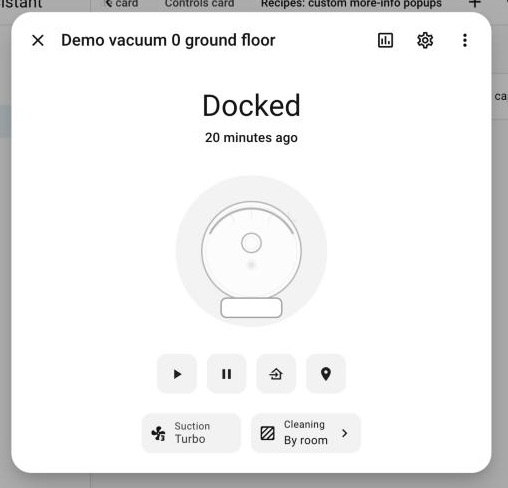
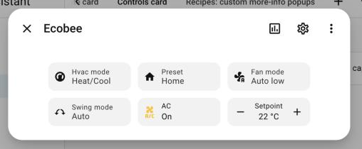
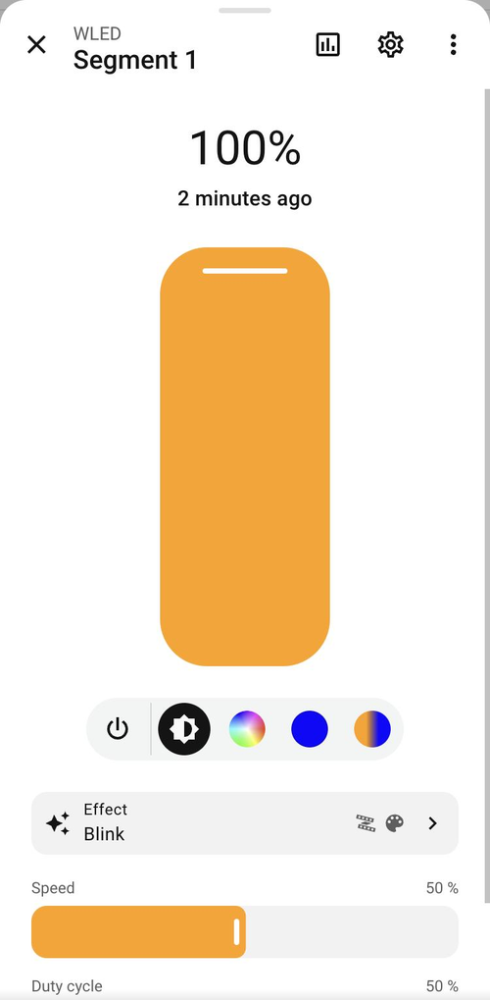
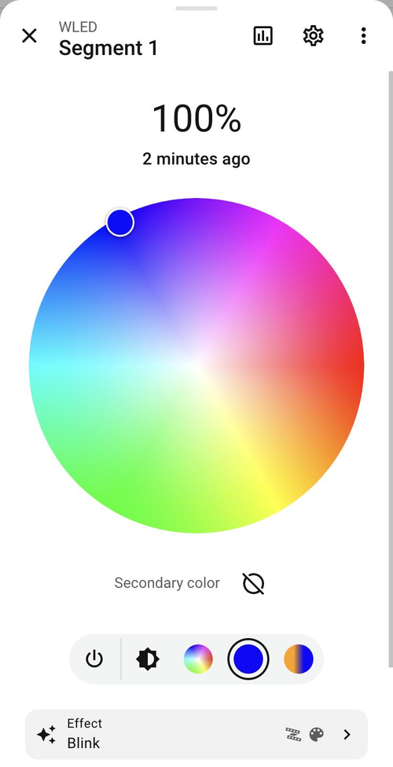
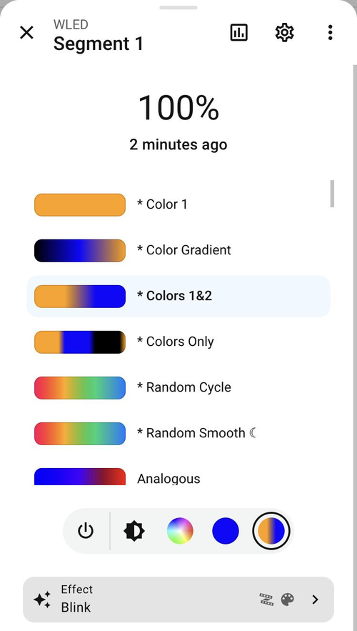
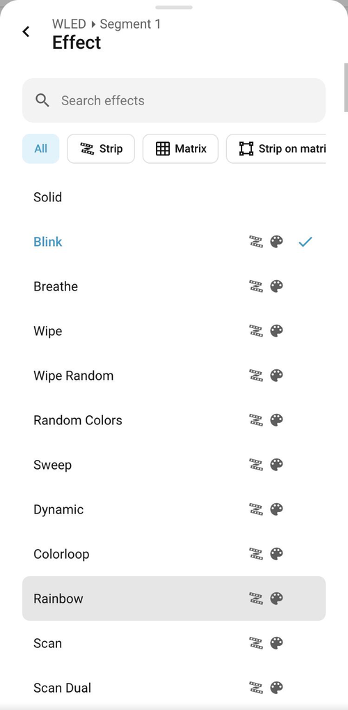
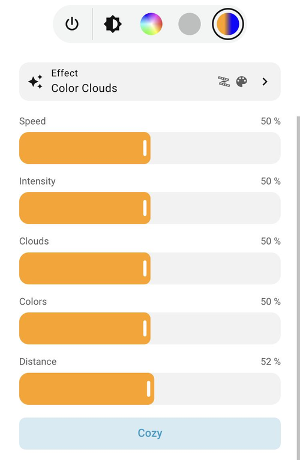
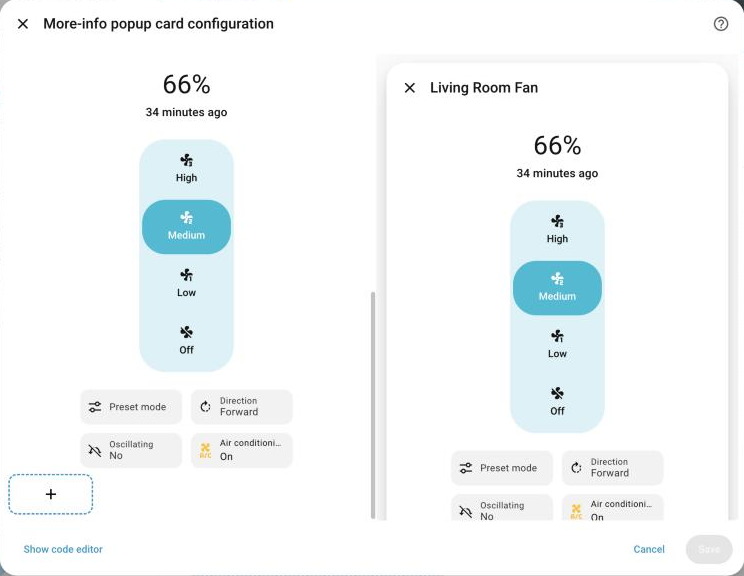

# More-Info Popup Card

A Home Assistant container card that opens as a popup **indistinguishable from the
native more-info dialog**: same dialog, header, animations, bottom sheet on
mobile and back-button behavior. Its body is a **sections grid** of any cards,
edited with the **native visual editor** (drag & drop, resize, copy / cut /
paste, duplicate, delete with undo, per-card visibility).

Optionally bind it to an entity to get the native history, settings and ⋮ menu
in the header, and to **replace that entity's more-info** everywhere on the view.

It also ships the native **building blocks of a more-info dialog** as cards (the
state header with its big control, and the row of chips with selects, toggles,
numbers, actions and command buttons) so a popup can be a fully **customized
more-info**, and a **[light more-info for WLED](#custommore-info-wled-state-card)**
with secondary color, palette previews and effects grouped like in WLED.

Requires Home Assistant **2026.10** or newer. 📖 **[Documentation with ~70
captured examples](docs/README.md)**.

| Popup bound to an entity              | Custom vacuum more-info                            | On a phone                                   |
| ------------------------------------- | -------------------------------------------------- | -------------------------------------------- |
|  |  |  |

## Installation

**HACS:** add this repository as a custom repository (type _Dashboard_),
install _More-Info Popup Card_ and reload the browser. To try the latest
changes before a release, open the card in HACS, choose _Redownload_ and pick
`main` in the version list (`dist/` is always built on `main`).

**Manual:** copy `dist/more-info-popup-card.js` to `config/www/` and add it as a
dashboard resource (`/local/more-info-popup-card.js`, type _JavaScript module_).

> Load it as a **dashboard resource** (HACS does this), not with
> `frontend: extra_module_url`. Home Assistant loads a scoped custom element
> registry polyfill, and a module that runs before it can register its cards
> outside the registry dashboards look them up in ("Custom element doesn't exist").

## Usage

1. Edit a dashboard and add the **More-info popup** card anywhere on the view.
   It is invisible on the dashboard and shows as a placeholder in edit mode.
2. Give it a **popup ID** (for example `living_room`) and add cards to it.
3. Open it from any card with a **Navigate** action to `#living_room`.

```yaml
type: custom:more-info-popup-card
popup_id: living_room
entity: light.living_room # optional
replace_more_info: true # optional: opening the entity shows this popup
cards:
  - type: heading
    heading: Lights
  - type: tile
    entity: light.living_room
    features:
      - type: light-brightness
  - type: tile
    entity: light.reading_lamp
```

### Ways to open a popup

| Trigger                                | How                                                                              |
| -------------------------------------- | -------------------------------------------------------------------------------- |
| Navigate action                        | `tap_action: { action: navigate, navigation_path: "#living_room" }`              |
| Entity more-info (`replace_more_info`) | Any card on the view that opens the entity's more-info opens the popup instead   |
| `fire-dom-event`                       | `tap_action: { action: fire-dom-event, more_info_popup: { open: living_room } }` |
| Link / bookmark                        | `/dashboard/view#living_room`                                                    |

`fire-dom-event` also accepts `close` (optionally with an ID) and `toggle`;
`open` and `toggle` take an optional `entity` for popups that use `entity: this`.

### Options

More examples for every option: [docs/popup-card.md](docs/popup-card.md).

| Option                | Default  | Description                                                                                                                                   |
| --------------------- | -------- | --------------------------------------------------------------------------------------------------------------------------------------------- |
| `popup_id`            | required | Lowercase letters, digits, `_` and `-`. Used as `#popup_id`.                                                                                  |
| `entity`              |          | Enables history, settings and the ⋮ menu (device info, related, details, add to…).                                                            |
| `name`                | entity   | Title of the popup.                                                                                                                           |
| `icon`                |          | Icon of the placeholder shown in edit mode.                                                                                                   |
| `breadcrumb`          | `auto`   | Text above the title: `auto` (area ▸ device), `none` or any text.                                                                             |
| `mode`                | `auto`   | `auto` (dialog on desktop, bottom sheet on mobile, like HA), `dialog`, `bottom_sheet` or `top_sheet` (drops from the top; swipe up to close). |
| `width`               | `medium` | `small`, `medium`, `large`, `full` or `custom` (+ `custom_width`, e.g. `720px`).                                                              |
| `height`              | `auto`   | `auto` or `custom` (+ `min_height` / `max_height`, e.g. `60vh`).                                                                              |
| `column_span`         | `1`      | Grid width in sections: `1` = 12 columns, `2` = 24 columns (opens a large dialog).                                                            |
| `show_header_actions` | `true`   | Show history, settings and menu when an entity is set.                                                                                        |
| `replace_more_info`   | `false`  | Show this popup instead of the entity's native more-info on this view.                                                                        |
| `match`               |          | With `replace_more_info`: also replace the more-info of these entities. See [One popup for many entities](#one-popup-for-many-entities).      |
| `nested_more_info`    | `inline` | Entities opened from inside the popup: `inline` (navigate inside, like HA) or `dialog`.                                                       |
| `dismissable`         | `true`   | Close with Esc, clicking outside or swiping down.                                                                                             |
| `auto_close`          | `0`      | Seconds of inactivity before closing (`0` = never).                                                                                           |
| `keep_alive`          | `false`  | Keep the cards loaded while closed for a faster reopen.                                                                                       |

### One popup for many entities

A popup with `match` replaces the more-info of every entity it matches, so a
dashboard full of WLED lights needs a single popup. In its cards, `entity: this`
is the entity that was opened, which also becomes the popup's entity (title,
area ▸ device breadcrumb, history, settings and ⋮ menu, like the native header).

Add this one card to a view and every WLED light on it (each segment and the
main light) opens the [WLED card](#custommore-info-wled-state-card) instead of
the native more-info:

```yaml
type: custom:more-info-popup-card
popup_id: wled_lights
replace_more_info: true
match:
  integration: wled # lights provided by the WLED integration
  domain: light
cards:
  - type: custom:more-info-wled-state-card
    entity: this
```

It works for any integration or domain. Every cover on the view, with the
native state header and controls plus open/close buttons:

```yaml
type: custom:more-info-popup-card
popup_id: covers
replace_more_info: true
match:
  domain: cover
cards:
  - type: custom:more-info-state-card
    entity: this
  - type: tile
    entity: this
    features:
      - type: cover-open-close
```

Or only some lights, by entity ID: `match: { entity_glob: light.living_room_* }`.

| `match` key   | Matches                                                |
| ------------- | ------------------------------------------------------ |
| `integration` | Entities provided by this integration (`wled`, `hue`…) |
| `domain`      | Entities of this domain (`light`, `switch`…)           |
| `entity_glob` | Entity IDs matching the pattern; `*` matches any text  |
| `entities`    | These entities, always (whatever the other keys say)   |

`integration`, `domain` and `entity_glob` must all match. `this` is replaced in
`entity`, `entity_id` and `entities` lists at any depth of the cards. When
several popups apply to an entity, the one with that `entity` wins, then an
`entities` entry, then the one with more criteria, then the last one on the view.

### Notes

- A popup is available on the views where its card is placed.
- Child cards support the usual `grid_options` and `visibility` options.
- In the editor, **Test popup** opens the real popup with the unsaved configuration.

## Building blocks for custom more-info popups

Two extra cards reproduce the native pieces of a more-info dialog, so a popup
can be a fully customized more-info. Each piece looks native by default; every
option you set is applied on top.

### `custom:more-info-state-card`

The state header ("Off · 3 hours ago", "66 %") and the big native control.
Every control with a screenshot: [docs/state-card.md](docs/state-card.md).

```yaml
type: custom:more-info-state-card
entity: fan.living_room
control: auto # auto | none | toggle | brightness | fan_speed | position | tilt | cover_toggle | cover_buttons | valve_position | valve_toggle | valve_buttons | lock | alarm_modes | temperature | climate_humidity | humidity | water_heater | vacuum_status | lawn_mower_status | media_player | more_info | script | press | trigger | push
show_state: true # default: like more-info (climate, humidifier and water heater have none)
show_last_changed: true
state_override: "" # replaces the state text
icon: mdi:string-lights # replaces the entity icon (toggle "on" icon, trigger, push)
icon_off: mdi:string-lights-off # toggle "off" icon
color: purple # active color of the control: theme color name or any CSS color
color_off: "#9e9e9e" # inactive color
button_layout: vertical # push only: vertical | horizontal | square | circle
show_cancel: true # Cancel button under a running script (trigger, push)
appearance: plain # plain (like more-info) | card
```

### `custom:more-info-controls-card`

The row of chips at the bottom of more-info, plus the command buttons above it.
Every item type and attribute with a screenshot:
[docs/controls-card.md](docs/controls-card.md); complete popups:
[docs/recipes.md](docs/recipes.md).


Mix any of these item types:

| `type`   | Looks like                   | Does                                                                                            |
| -------- | ---------------------------- | ----------------------------------------------------------------------------------------------- |
| `select` | native select menu chip      | `select` / `input_select` entities, or an attribute with options (see below)                    |
| `toggle` | chip with name and state     | turns the entity on / off                                                                       |
| `number` | chip with − value +          | `number` / `input_number` (`min`, `max`, `step` optional)                                       |
| `action` | chip with optional chevron   | any `tap_action`: open another popup (`navigate` to `#id`), more-info, perform an action…       |
| `button` | native square command button | `perform_action` (e.g. `vacuum.start`) or `tap_action`; `button`/`scene`/`script` work directly |

On phones the chips row scrolls sideways, like Home Assistant; `wrap: true` puts the chips in rows instead.

The type is inferred when omitted. Select attributes: `effect`, `preset_mode`,
`fan_mode`, `hvac_mode`, `swing_mode`, `swing_horizontal_mode`, `fan_speed`, `mode`,
`direction`, `oscillating`, `operation_mode`, `away_mode`, `source`, `sound_mode`
(each calls the same service as the native control), or any attribute with your
own `options` + `perform_action` + `data_key`.

```yaml
type: custom:more-info-controls-card
controls:
  - type: button
    entity: vacuum.robot
    icon: mdi:play
    perform_action: vacuum.start
  - entity: vacuum.robot
    attribute: fan_speed
    name: Suction
    options: # filter, order, rename and re-icon (renaming is YAML only)
      - { value: min, name: Quiet, icon: mdi:fan-speed-1 }
      - { value: max, name: Turbo, icon: mdi:fan-speed-3 }
  - entity: switch.child_lock
    color: red # icon color (toggles: only while on)
  - entity: number.volume
  - type: action
    name: Cleaning
    value: By room
    icon: mdi:texture-box
    tap_action: { action: navigate, navigation_path: "#rooms" }
```

### `custom:more-info-wled-state-card`

A light more-info made for **[WLED](https://kno.wled.ge/)** lights. It is the
native light more-info (same header, brightness slider, color wheel, color
temperature and button bar), plus everything WLED can do that Home
Assistant's WLED integration doesn't show:

- the **secondary color** (and the tertiary one, when the effect uses it),
- the **palettes with their previews**, like in WLED's own interface,
- a **searchable effect list grouped like WLED's**: strip, matrix, strip on
  matrix, audio reactive (volume / frequency) and effects that use a palette,
- the **sliders and options of the current effect**, with the names WLED gives
  them (Speed, Intensity, or "Duty cycle", "Clouds", "Distance"…), only the
  ones the effect uses.

It is meant for **segment lights of the WLED integration** (`light.wled`,
`light.wled_segment_1`…). The "main" light WLED creates for multi-segment
devices only has a brightness, so it gets the plain light controls (power and
brightness) without the WLED extras.

| Overview                                    | Secondary color                                    | Palettes with previews                     |
| ------------------------------------------- | -------------------------------------------------- | ------------------------------------------ |
|  |  |  |

| Dynamic palettes (from the segment colors)                 | Effects                                  | Effects filtered by category                         |
| ---------------------------------------------------------- | ---------------------------------------- | ---------------------------------------------------- |
|  |  |  |

```yaml
type: custom:more-info-wled-state-card
entity: light.wled_segment_1
show_state: true # header with the brightness and the last change
show_last_changed: true
show_effects: true # effect, its sliders and options
host: http://192.168.1.50 # optional: defaults to the device's address in HA
appearance: plain # plain (like more-info) | card
```

#### The button bar

Like the light more-info, the round buttons under the main control switch what
it shows. The WLED card adds two:

| Button             | Main control                                                                                                                                                                               |
| ------------------ | ------------------------------------------------------------------------------------------------------------------------------------------------------------------------------------------ |
| ⏻                  | turns the segment on / off                                                                                                                                                                 |
| brightness         | the native brightness slider                                                                                                                                                               |
| color wheel        | the native color wheel (primary color)                                                                                                                                                     |
| **filled circle**  | **secondary color**: a color wheel for WLED's second color slot, shown in the button. With effects that use a third color, the wheel switches between both; ⊘ sets the slot to black (off) |
| color temperature  | the native color temperature picker, for segments that have it                                                                                                                             |
| **palette swatch** | **palettes**: every palette with its preview, the current one highlighted. The `*` palettes are drawn with the segment's colors                                                            |

The secondary color and palette buttons are disabled when the current effect
doesn't use them, exactly like WLED hides them in its own interface.

#### Effects

The **Effect** row shows the current effect and its categories. It opens the
effect list: inside a popup as a native sub-view with a back arrow, on a
dashboard right below the row. Search by name, filter by category, and pick:
the list closes and the light changes.

| Icon (Material Design) | Category                                              |
| ---------------------- | ----------------------------------------------------- |
| LED strip              | strip (1D)                                            |
| grid                   | matrix (2D)                                           |
| square outline         | strip effect expanded on a matrix (1.5D, MoonModules) |
| speaker                | audio reactive, volume (needs the audio usermod)      |
| waveform               | audio reactive, frequency                             |
| palette                | uses the palette                                      |

Under the row come the **sliders and options of the current effect**, named
and shown the way WLED's metadata describes them: an effect without sliders
shows none, "Blink" shows Speed and Duty cycle, "Color Clouds" shows Speed,
Intensity, Clouds, Colors, Distance and the Cozy option.



#### How it talks to WLED

Brightness, the primary color, the effect, the palette, speed and intensity go
through Home Assistant (the WLED integration's light, select and number
entities). The secondary / tertiary colors, the custom sliders and options, the
palette previews and the effect metadata are not exposed by the integration, so
the card reads them **straight from the device's JSON API** (`/json/state`,
`/json/palx`, `/json/fxdata`), which WLED allows from the browser.

That needs the **browser to reach the device**, at the address Home Assistant
has for it (its configuration URL) or the one in `host`:

- On your network, with Home Assistant opened over `http://`, it just works.
- If Home Assistant is opened over `https://` (Nabu Casa, a reverse proxy…),
  browsers block calls to an `http://` device. Set `host` to an `https://`
  address of the device (for example a reverse proxy), or use the card from
  your network over http.
- Away from home (no access to the device), those parts are hidden and the
  card keeps working with what Home Assistant offers: brightness, colors,
  effect list, palettes by name, speed and intensity. A short note under the
  card says why.

The effect and palette catalog is read once per firmware version and kept in
the browser.

## Visual editor

Popups and their cards are edited in Home Assistant's own editor: a native
sections grid with drag & drop, the card menu (edit, duplicate, copy, cut,
delete with undo), the shared clipboard and per-card Visibility / Layout tabs.
See [docs/editor.md](docs/editor.md).



## UIX theming

Details and theme keys: [docs/uix.md](docs/uix.md).

Everything can be styled with [UIX](https://github.com/Lint-Free-Technology/uix)
(and legacy `card_mod`):

- **Cards** (popup children, state and controls cards): the usual `uix:` key on
  each card, applied by UIX like on any native card.
- **The popup:** `uix:` on the popup card styles the dialog of that popup. Theme keys:
  `uix-more-info-popup` / `uix-more-info-popup-yaml` for all popups, and your existing
  `uix-more-info` theme applies too, so popups match the native more-info.
  UIX's generic `uix-dialog` also applies (class `type-more-info-popup-dialog`).

```yaml
type: custom:more-info-popup-card
popup_id: living_room
uix:
  style: |
    :host {
      --ha-dialog-surface-background: rgba(20, 20, 30, 0.85);
      --ha-dialog-surface-backdrop-filter: blur(12px);
    }
cards: []
```

## Documentation

| Page                                   | Content                                         |
| -------------------------------------- | ----------------------------------------------- |
| [Popup card](docs/popup-card.md)       | 17 examples: basics, sizes, presentation, views |
| [State card](docs/state-card.md)       | 21 examples: every native control and option    |
| [Controls card](docs/controls-card.md) | 18 examples: every chip type and attribute      |
| [Recipes](docs/recipes.md)             | 8 complete custom more-info popups              |
| [Visual editor](docs/editor.md)        | The editing workflow                            |
| [UIX theming](docs/uix.md)             | Styling cards and popups                        |
| [Test plan](docs/testing.md)           | What was verified and how                       |

## Development

```bash
npm install
npm run watch          # rebuilds dist/ on change
npm run dev:ha         # local Home Assistant 2026.10 on http://localhost:8123
node dev/onboard.mjs   # creates a test user and the "Popup lab" dashboard
node dev/docs.mjs dashboard   # installs the documentation examples ("Popup docs")
npm run typecheck && npm run lint && npm test
```

The card reuses Home Assistant's own frontend elements (`ha-adaptive-dialog`,
`hui-section`, `hui-card-element-editor`, `hui-card-picker`, the `ha-more-info-*`
views). All of them are accessed through `src/ha/`, which feature-detects them so
a frontend change is easy to spot. See [PLAN.md](PLAN.md) for the design.

## License

[MIT](LICENSE)
