# Popup card

<!-- Generated by `node dev/docs.mjs markdown` from docs/catalog.mjs. Do not edit. -->

`custom:more-info-popup-card` is a container: it is invisible on the dashboard and opens as a popup that uses Home Assistant's own more-info dialog. Its body is a sections grid of any cards.

[← Documentation index](README.md)

- [Basics](#basics)
  - [A popup without entity](#a-popup-without-entity)
  - [Bound to an entity](#bound-to-an-entity)
  - [Custom title and breadcrumb](#custom-title-and-breadcrumb)
  - [Entity without header buttons](#entity-without-header-buttons)
- [Size](#size)
  - [Small](#small)
  - [Large with a 24-column grid](#large-with-a-24-column-grid)
  - [Custom width](#custom-width)
  - [Custom height](#custom-height)
- [Presentation](#presentation)
  - [Bottom sheet on desktop](#bottom-sheet-on-desktop)
  - [Automatic on a phone](#automatic-on-a-phone)
  - [Dialog forced on a phone](#dialog-forced-on-a-phone)
- [Entity views](#entity-views)
  - [History](#history)
  - [Settings](#settings)
  - [Related](#related)
  - [Details / attributes](#details-attributes)
  - [The ⋮ menu](#the-menu)
  - [Entities opened from inside](#entities-opened-from-inside)
- [Opening a popup](#opening-a-popup)
  - [Navigate action](#navigate-action)
  - [Replace an entity's more-info](#replace-an-entitys-more-info)
  - [One popup for many entities](#one-popup-for-many-entities)
  - [fire-dom-event](#fire-dom-event)
  - [Links and bookmarks](#links-and-bookmarks)
- [Behavior](#behavior)
  - [Closing and lifecycle](#closing-and-lifecycle)

## Basics

### A popup without entity

Only `popup_id` and `cards` are needed. Open it with a Navigate action to `#basic`.

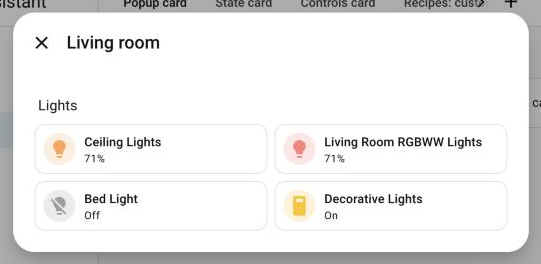

```yaml
type: custom:more-info-popup-card
popup_id: basic
name: "Living room"
cards:
  - type: heading
    heading: Lights
  - type: tile
    entity: light.ceiling_lights
  - type: tile
    entity: light.living_room_rgbww_lights
  - type: tile
    entity: light.bed_light
  - type: tile
    entity: switch.decorative_lights
```

### Bound to an entity

With `entity`, the header shows the native history, settings and ⋮ menu, and the title, breadcrumb and views follow that entity.

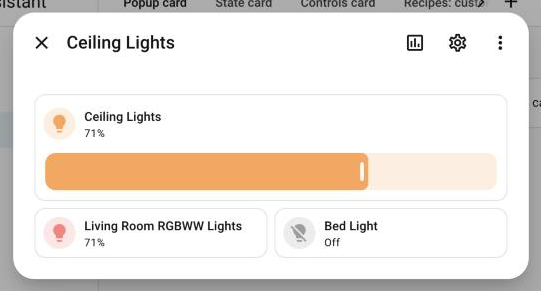

```yaml
type: custom:more-info-popup-card
popup_id: with_entity
entity: light.ceiling_lights
cards:
  - type: tile
    entity: light.ceiling_lights
    features:
      - type: light-brightness
    grid_options:
      columns: 12
  - type: tile
    entity: light.living_room_rgbww_lights
  - type: tile
    entity: light.bed_light
```

### Custom title and breadcrumb

`name` replaces the title and `breadcrumb` the text above it (`auto` = area ▸ device, `none`, or any text).

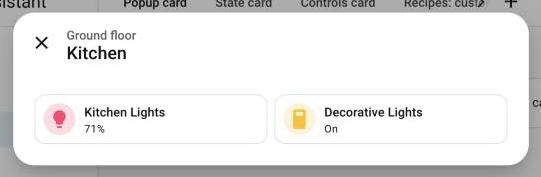

```yaml
type: custom:more-info-popup-card
popup_id: breadcrumb_text
name: Kitchen
breadcrumb: "Ground floor"
icon: mdi:silverware-fork-knife
cards:
  - type: tile
    entity: light.kitchen_lights
  - type: tile
    entity: switch.decorative_lights
```

### Entity without header buttons

`show_header_actions: false` keeps the entity title but hides history, settings and the menu.

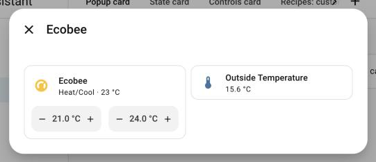

```yaml
type: custom:more-info-popup-card
popup_id: no_header_actions
entity: climate.ecobee
show_header_actions: false
cards:
  - type: tile
    entity: climate.ecobee
    features:
      - type: target-temperature
  - type: tile
    entity: sensor.outside_temperature
```

## Size

### Small

`width: small` (320 px).

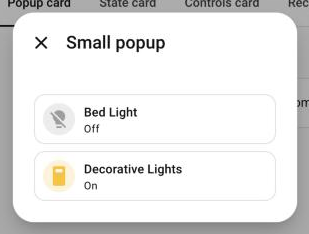

```yaml
type: custom:more-info-popup-card
popup_id: width_small
name: "Small popup"
width: small
cards:
  - type: tile
    entity: light.bed_light
    grid_options:
      columns: 12
  - type: tile
    entity: switch.decorative_lights
    grid_options:
      columns: 12
```

### Large with a 24-column grid

`column_span: 2` gives a 24-column grid (two dashboard sections wide) and opens a large dialog.

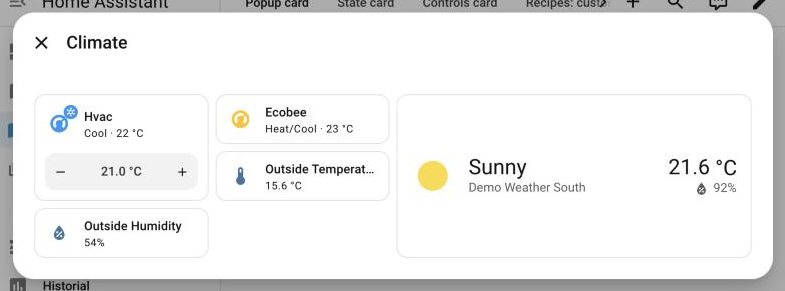

```yaml
type: custom:more-info-popup-card
popup_id: width_large
name: Climate
column_span: 2
cards:
  - type: tile
    entity: climate.hvac
    features:
      - type: target-temperature
  - type: tile
    entity: climate.ecobee
  - type: weather-forecast
    entity: weather.demo_weather_south
    grid_options:
      columns: 12
  - type: tile
    entity: sensor.outside_temperature
  - type: tile
    entity: sensor.outside_humidity
```

### Custom width

`width: custom` with any CSS length in `custom_width`.

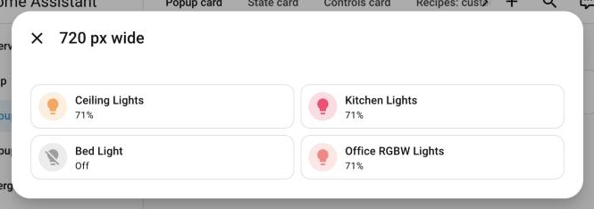

```yaml
type: custom:more-info-popup-card
popup_id: width_custom
name: "720 px wide"
width: custom
custom_width: "720px"
cards:
  - type: tile
    entity: light.ceiling_lights
  - type: tile
    entity: light.kitchen_lights
  - type: tile
    entity: light.bed_light
  - type: tile
    entity: light.office_rgbw_lights
```

### Custom height

`height: custom` with `min_height` / `max_height` (here both `60vh`). Longer content scrolls inside, with the native scroll fades.

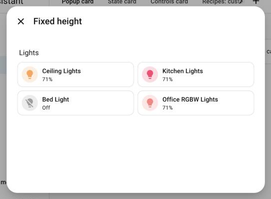

```yaml
type: custom:more-info-popup-card
popup_id: height_custom
name: "Fixed height"
height: custom
min_height: "60vh"
max_height: "60vh"
cards:
  - type: heading
    heading: Lights
  - type: tile
    entity: light.ceiling_lights
  - type: tile
    entity: light.kitchen_lights
  - type: tile
    entity: light.bed_light
  - type: tile
    entity: light.office_rgbw_lights
```

## Presentation

### Bottom sheet on desktop

`mode: bottom_sheet` always slides up from the bottom, with the native drag handle. `mode: top_sheet` is the same sheet dropping from the top like a marquee, with the handle at the bottom: swipe up to close.

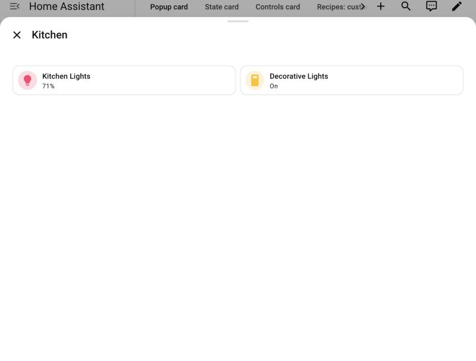

```yaml
type: custom:more-info-popup-card
popup_id: sheet_desktop
name: Kitchen
mode: bottom_sheet
cards:
  - type: tile
    entity: light.kitchen_lights
  - type: tile
    entity: switch.decorative_lights
```

### Automatic on a phone

`mode: auto` (default) behaves like Home Assistant: dialog on large screens, bottom sheet on phones.

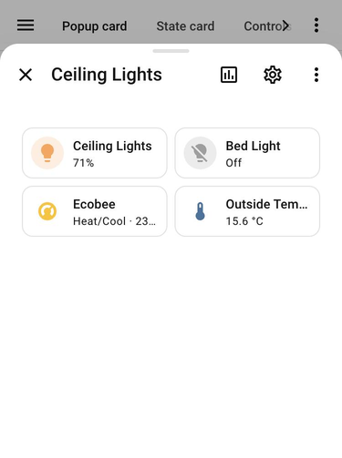

```yaml
type: custom:more-info-popup-card
popup_id: auto_mobile
entity: light.ceiling_lights
cards:
  - type: tile
    entity: light.ceiling_lights
  - type: tile
    entity: light.bed_light
  - type: tile
    entity: climate.ecobee
  - type: tile
    entity: sensor.outside_temperature
```

### Dialog forced on a phone

`mode: dialog` keeps the dialog; like native dialogs it becomes full screen on small phones.

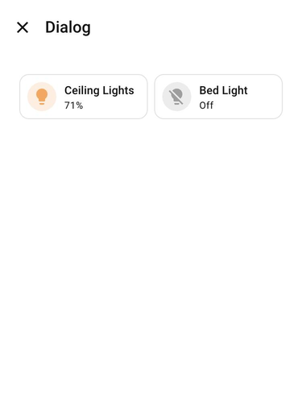

```yaml
type: custom:more-info-popup-card
popup_id: dialog_mobile
name: Dialog
mode: dialog
cards:
  - type: tile
    entity: light.ceiling_lights
  - type: tile
    entity: light.bed_light
```

## Entity views

With an entity, the header buttons open the native views inside the popup, with the back arrow, exactly like the more-info dialog.

### History

Chart button.

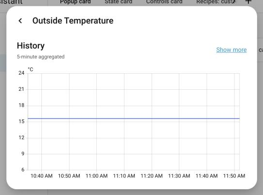

```yaml
type: custom:more-info-popup-card
popup_id: view_history
entity: sensor.outside_temperature
replace_more_info: true
cards:
  - type: tile
    entity: sensor.outside_temperature
```

### Settings

Cog button (admins).

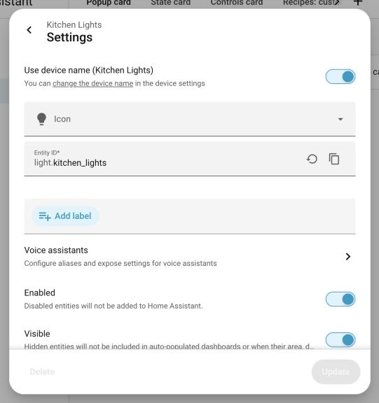

```yaml
type: custom:more-info-popup-card
popup_id: view_settings
entity: light.kitchen_lights
replace_more_info: true
cards:
  - type: tile
    entity: light.kitchen_lights
```

### Related

Menu ▸ Related, or click the breadcrumb.

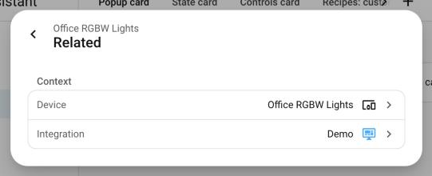

```yaml
type: custom:more-info-popup-card
popup_id: view_related
entity: light.office_rgbw_lights
replace_more_info: true
cards:
  - type: tile
    entity: light.office_rgbw_lights
```

### Details / attributes

Menu ▸ Details, with the YAML toggle.

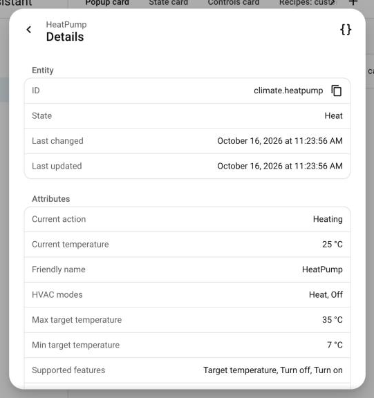

```yaml
type: custom:more-info-popup-card
popup_id: view_details
entity: climate.heatpump
replace_more_info: true
cards:
  - type: tile
    entity: climate.heatpump
```

### The ⋮ menu

Same entries as the native menu, plus **Entity controls** (the native more-info of the entity).

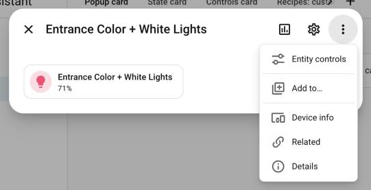

```yaml
type: custom:more-info-popup-card
popup_id: view_menu
entity: light.entrance_color_white_lights
cards:
  - type: tile
    entity: light.entrance_color_white_lights
```

### Entities opened from inside

`nested_more_info: inline` (default): a card inside the popup that opens a more-info navigates inside the popup, with the back arrow. Use `dialog` to open a separate dialog instead.

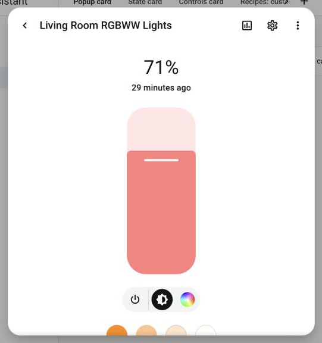

```yaml
type: custom:more-info-popup-card
popup_id: nested_inline
name: Lights
cards:
  - type: tile
    entity: light.living_room_rgbww_lights
  - type: tile
    entity: light.bed_light
```

## Opening a popup

A popup is available on the views where its card is placed.

### Navigate action

From any card, badge or button. The hash is consumed, so the browser history keeps a single entry and Back closes the popup.

```yaml
type: tile
entity: light.ceiling_lights
tap_action:
  action: navigate
  navigation_path: "#basic"
```

### Replace an entity's more-info

With `replace_more_info: true`, anything on the view that opens the entity's more-info (tiles, the search, history…) opens the popup instead. Requested views (history, settings…) open inside the popup.

```yaml
type: custom:more-info-popup-card
popup_id: living_room
entity: light.ceiling_lights
replace_more_info: true
cards: []
```

### One popup for many entities

With `match`, one popup replaces the more-info of every entity it matches: `integration` (the integration that provides the entity), `domain` and `entity_glob` (`*` matches any text) must all match, and `entities` are always included. The opened entity becomes the popup's entity (title, history, settings, menu) and replaces `this` in `entity: this`, `entity_id: this` and `entities` lists of the cards. When several popups match, the one with that `entity` wins, then an `entities` entry, then the one with more criteria.

```yaml
type: custom:more-info-popup-card
popup_id: wled
replace_more_info: true
match:
  integration: wled
  domain: light
cards:
  - type: custom:more-info-wled-state-card
    entity: this
```

### fire-dom-event

`open`, `close` (optionally with an id) and `toggle`. `open` and `toggle` also take an `entity` for popups that use `entity: this`.

```yaml
type: button
name: "Toggle living room"
tap_action:
  action: fire-dom-event
  more_info_popup:
    toggle: living_room
```

### Links and bookmarks

`/dashboard/view#living_room` opens the popup when the view loads.

## Behavior

### Closing and lifecycle

`dismissable: false` ignores Esc, outside clicks and swipes (the ✕ still closes). `auto_close` closes after N seconds without interaction. `keep_alive` keeps the cards loaded while closed for a faster reopen.

```yaml
type: custom:more-info-popup-card
popup_id: doorbell
dismissable: false
auto_close: 30
keep_alive: true
cards: []
```
