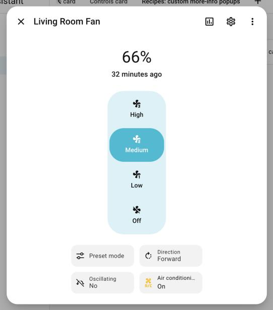
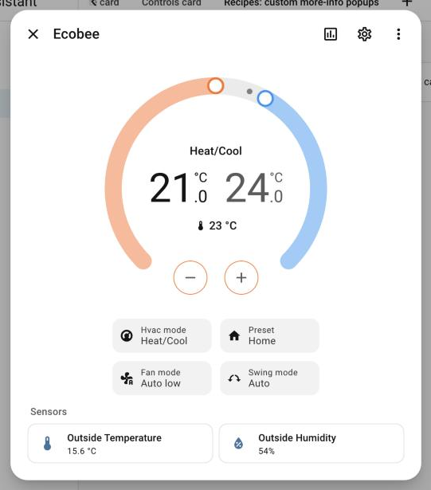
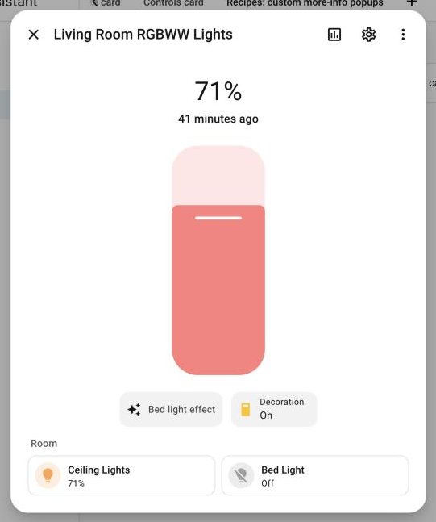
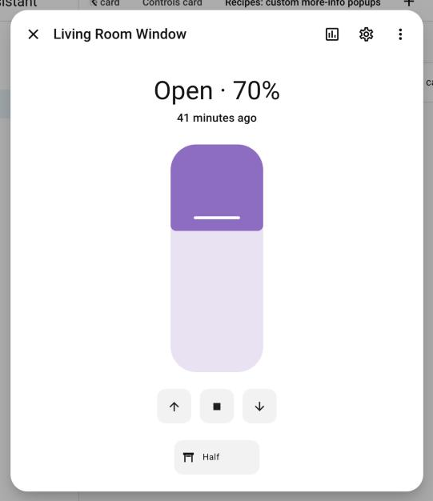
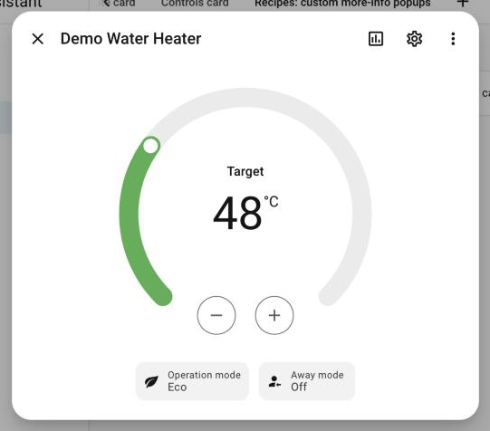
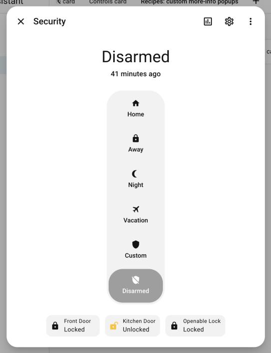
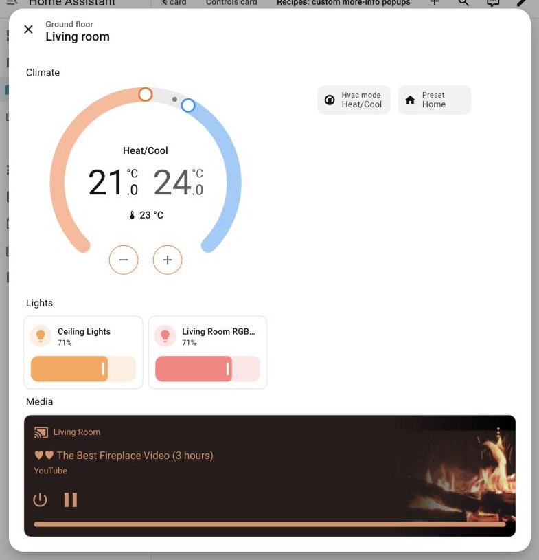

# Recipes: custom more-info popups

<!-- Generated by `node dev/docs.mjs markdown` from docs/catalog.mjs. Do not edit. -->

Complete popups that replace the native more-info of an entity (`replace_more_info: true`) with a customized one built from the state and controls cards plus any other card.

[← Documentation index](README.md)

- [Recipes](#recipes)
  - [Vacuum](#vacuum)
  - [Fan](#fan)
  - [Thermostat](#thermostat)
  - [Light](#light)
  - [Cover](#cover)
  - [Water heater](#water-heater)
  - [Security](#security)
  - [A room](#a-room)

## Recipes

### Vacuum

Status, command buttons, renamed suction levels and a chip that opens a rooms popup.


```yaml
type: custom:more-info-popup-card
popup_id: recipe_vacuum
entity: vacuum.demo_vacuum_0_ground_floor
replace_more_info: true
cards:
  - type: custom:more-info-state-card
    entity: vacuum.demo_vacuum_0_ground_floor
  - type: custom:more-info-controls-card
    controls:
      - type: button
        entity: vacuum.demo_vacuum_0_ground_floor
        name: Start
        icon: mdi:play
        perform_action: vacuum.start
      - type: button
        entity: vacuum.demo_vacuum_0_ground_floor
        name: Pause
        icon: mdi:pause
        perform_action: vacuum.pause
      - type: button
        entity: vacuum.demo_vacuum_0_ground_floor
        name: Dock
        icon: mdi:home-import-outline
        perform_action: vacuum.return_to_base
      - type: button
        entity: vacuum.demo_vacuum_0_ground_floor
        name: Locate
        icon: mdi:map-marker
        perform_action: vacuum.locate
      - entity: vacuum.demo_vacuum_0_ground_floor
        attribute: fan_speed
        name: Suction
        options:
          - value: min
            name: Quiet
            icon: mdi:fan-speed-1
          - value: medium
            name: Normal
            icon: mdi:fan-speed-2
          - value: max
            name: Turbo
            icon: mdi:fan-speed-3
      - type: action
        name: Cleaning
        value: "By room"
        icon: mdi:texture-box
        tap_action:
          action: navigate
          navigation_path: "#recipe_room"
```

### Fan

Speed control, fan options and a related switch.



```yaml
type: custom:more-info-popup-card
popup_id: recipe_fan
entity: fan.living_room_fan
replace_more_info: true
cards:
  - type: custom:more-info-state-card
    entity: fan.living_room_fan
  - type: custom:more-info-controls-card
    controls:
      - entity: fan.living_room_fan
        attribute: preset_mode
      - entity: fan.living_room_fan
        attribute: direction
      - entity: fan.living_room_fan
        attribute: oscillating
      - entity: switch.ac
        name: "Air conditioning"
```

### Thermostat

Dial, a reduced set of HVAC modes and the room sensors.



```yaml
type: custom:more-info-popup-card
popup_id: recipe_thermostat
entity: climate.ecobee
replace_more_info: true
cards:
  - type: custom:more-info-state-card
    entity: climate.ecobee
  - type: custom:more-info-controls-card
    controls:
      - entity: climate.ecobee
        attribute: hvac_mode
        options:
          - "off"
          - heat_cool
          - cool
          - auto
      - entity: climate.ecobee
        attribute: preset_mode
      - entity: climate.ecobee
        attribute: fan_mode
      - entity: climate.ecobee
        attribute: swing_mode
  - type: heading
    heading: Sensors
    heading_style: subtitle
  - type: tile
    entity: sensor.outside_temperature
  - type: tile
    entity: sensor.outside_humidity
```

### Light

Brightness, effect, and the other lights of the room.



```yaml
type: custom:more-info-popup-card
popup_id: recipe_light
entity: light.living_room_rgbww_lights
replace_more_info: true
cards:
  - type: custom:more-info-state-card
    entity: light.living_room_rgbww_lights
  - type: custom:more-info-controls-card
    controls:
      - entity: light.bed_light
        attribute: effect
        name: "Bed light effect"
      - entity: switch.decorative_lights
        name: Decoration
  - type: heading
    heading: Room
    heading_style: subtitle
  - type: tile
    entity: light.ceiling_lights
  - type: tile
    entity: light.bed_light
```

### Cover

Position plus tilt as a second state card and favorite positions as buttons.



```yaml
type: custom:more-info-popup-card
popup_id: recipe_cover
entity: cover.living_room_window
replace_more_info: true
cards:
  - type: custom:more-info-state-card
    entity: cover.living_room_window
  - type: custom:more-info-controls-card
    controls:
      - type: button
        entity: cover.living_room_window
        name: Open
        icon: mdi:arrow-up
        perform_action: cover.open_cover
      - type: button
        entity: cover.living_room_window
        name: Stop
        icon: mdi:stop
        perform_action: cover.stop_cover
      - type: button
        entity: cover.living_room_window
        name: Close
        icon: mdi:arrow-down
        perform_action: cover.close_cover
      - type: action
        name: Half
        icon: mdi:window-shutter-open
        tap_action:
          action: perform-action
          perform_action: cover.set_cover_position
          target:
            entity_id: cover.living_room_window
          data:
            position: 50
```

### Water heater

Temperature, operation mode and away mode.



```yaml
type: custom:more-info-popup-card
popup_id: recipe_water_heater
entity: water_heater.demo_water_heater
replace_more_info: true
cards:
  - type: custom:more-info-state-card
    entity: water_heater.demo_water_heater
  - type: custom:more-info-controls-card
    controls:
      - entity: water_heater.demo_water_heater
        attribute: operation_mode
      - entity: water_heater.demo_water_heater
        attribute: away_mode
```

### Security

Alarm panel and locks in one popup.



```yaml
type: custom:more-info-popup-card
popup_id: recipe_security
entity: alarm_control_panel.security
replace_more_info: true
cards:
  - type: custom:more-info-state-card
    entity: alarm_control_panel.security
  - type: custom:more-info-controls-card
    controls:
      - entity: lock.front_door
      - entity: lock.kitchen_door
      - entity: lock.openable_lock
```

### A room

A popup without entity mixing building blocks and regular cards, wide on desktop.



```yaml
type: custom:more-info-popup-card
popup_id: recipe_room
name: "Living room"
breadcrumb: "Ground floor"
column_span: 2
cards:
  - type: heading
    heading: Climate
  - type: custom:more-info-state-card
    entity: climate.ecobee
    grid_options:
      columns: 12
  - type: custom:more-info-controls-card
    controls:
      - entity: climate.ecobee
        attribute: hvac_mode
      - entity: climate.ecobee
        attribute: preset_mode
    grid_options:
      columns: 12
  - type: heading
    heading: Lights
  - type: tile
    entity: light.ceiling_lights
    features:
      - type: light-brightness
  - type: tile
    entity: light.living_room_rgbww_lights
    features:
      - type: light-brightness
  - type: heading
    heading: Media
  - type: media-control
    entity: media_player.living_room
    grid_options:
      columns: 24
```
