# State card

<!-- Generated by `node dev/docs.mjs markdown` from docs/catalog.mjs. Do not edit. -->

`custom:more-info-state-card` renders the top of a native more-info: the state header (state and last changed) and the big native control. `control: auto` picks the same control as Home Assistant; any other value forces one.

[← Documentation index](README.md)

- [Controls](#controls)
  - [toggle](#toggle)
  - [brightness](#brightness)
  - [fan_speed](#fan_speed)
  - [position](#position)
  - [tilt](#tilt)
  - [cover_buttons](#cover_buttons)
  - [valve_position](#valve_position)
  - [valve_toggle](#valve_toggle)
  - [lock](#lock)
  - [alarm_modes](#alarm_modes)
  - [temperature](#temperature)
  - [climate_humidity](#climate_humidity)
  - [humidity](#humidity)
  - [water_heater](#water_heater)
  - [vacuum_status](#vacuum_status)
- [Options](#options)
  - [Custom state text](#custom-state-text)
  - [Without last changed](#without-last-changed)
  - [Header only](#header-only)
  - [A different control](#a-different-control)
  - [Control only](#control-only)
  - [Card appearance](#card-appearance)

## Controls

### toggle

Switches, input booleans, sirens, lights without brightness…

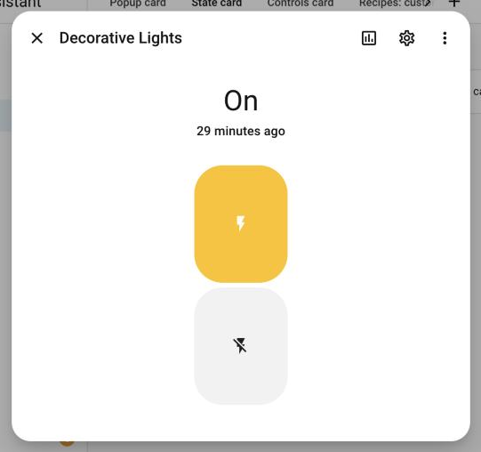

<sub>Shown inside a popup bound to `switch.decorative_lights`.</sub>

```yaml
type: custom:more-info-state-card
entity: switch.decorative_lights
```

### brightness

Lights with brightness. The header shows the brightness like more-info.

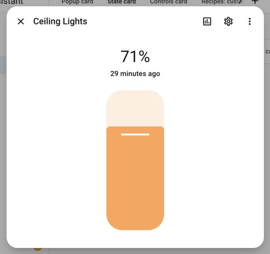

<sub>Shown inside a popup bound to `light.ceiling_lights`.</sub>

```yaml
type: custom:more-info-state-card
entity: light.ceiling_lights
```

### fan_speed

Fans with speeds (segments for few speeds, a slider otherwise).

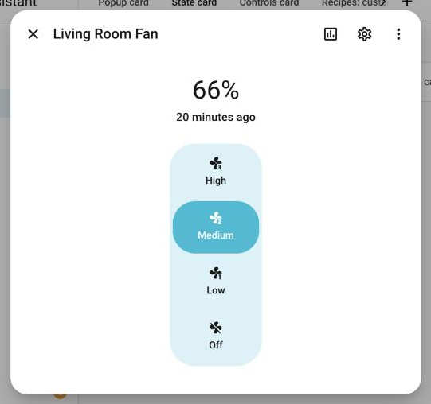

<sub>Shown inside a popup bound to `fan.living_room_fan`.</sub>

```yaml
type: custom:more-info-state-card
entity: fan.living_room_fan
```

### position

Covers with position. Header: state · position.

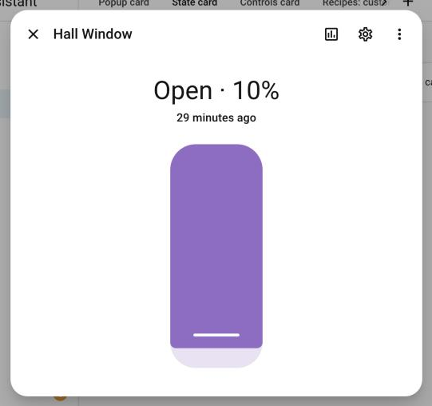

<sub>Shown inside a popup bound to `cover.hall_window`.</sub>

```yaml
type: custom:more-info-state-card
entity: cover.hall_window
```

### tilt

Cover tilt position.

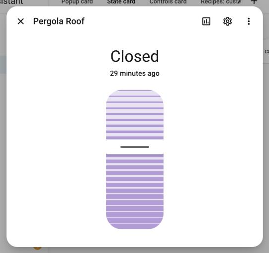

<sub>Shown inside a popup bound to `cover.pergola_roof`.</sub>

```yaml
type: custom:more-info-state-card
entity: cover.pergola_roof
control: tilt
```

### cover_buttons

Open / stop / close buttons.

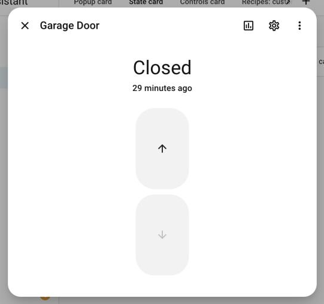

<sub>Shown inside a popup bound to `cover.garage_door`.</sub>

```yaml
type: custom:more-info-state-card
entity: cover.garage_door
```

### valve_position

Valves with position.

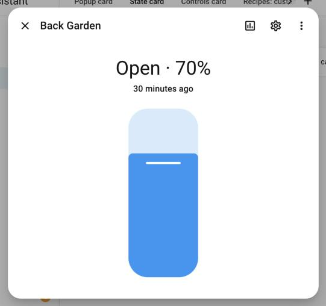

<sub>Shown inside a popup bound to `valve.back_garden`.</sub>

```yaml
type: custom:more-info-state-card
entity: valve.back_garden
```

### valve_toggle

Valves without position.

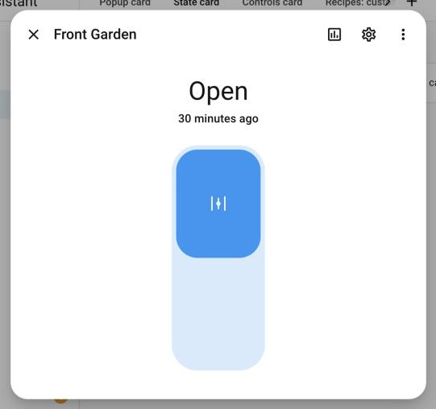

<sub>Shown inside a popup bound to `valve.front_garden`.</sub>

```yaml
type: custom:more-info-state-card
entity: valve.front_garden
```

### lock

Lock toggle.

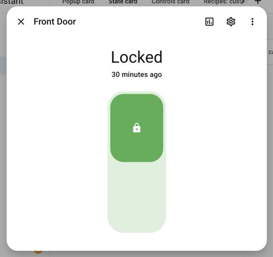

<sub>Shown inside a popup bound to `lock.front_door`.</sub>

```yaml
type: custom:more-info-state-card
entity: lock.front_door
```

### alarm_modes

Alarm panel modes.

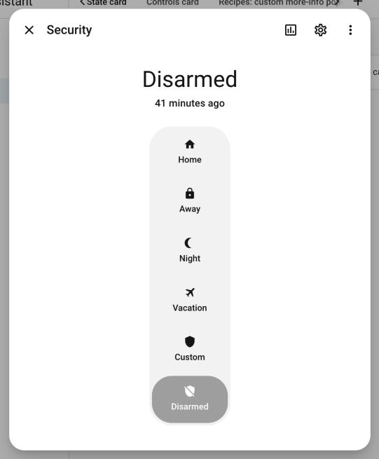

<sub>Shown inside a popup bound to `alarm_control_panel.security`.</sub>

```yaml
type: custom:more-info-state-card
entity: alarm_control_panel.security
```

### temperature

Thermostat dial. Climate has no state header natively.

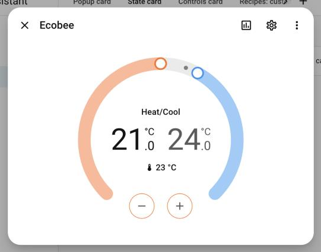

<sub>Shown inside a popup bound to `climate.ecobee`.</sub>

```yaml
type: custom:more-info-state-card
entity: climate.ecobee
```

### climate_humidity

Target humidity of a climate entity.

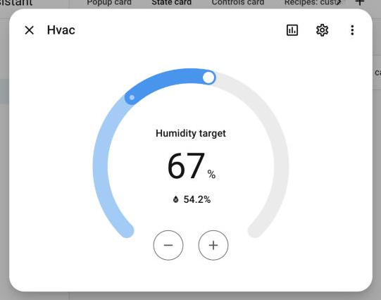

<sub>Shown inside a popup bound to `climate.hvac`.</sub>

```yaml
type: custom:more-info-state-card
entity: climate.hvac
control: climate_humidity
```

### humidity

Humidifiers.

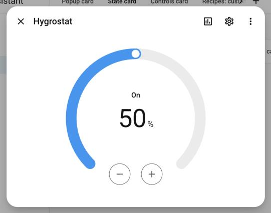

<sub>Shown inside a popup bound to `humidifier.hygrostat`.</sub>

```yaml
type: custom:more-info-state-card
entity: humidifier.hygrostat
```

### water_heater

Water heaters.

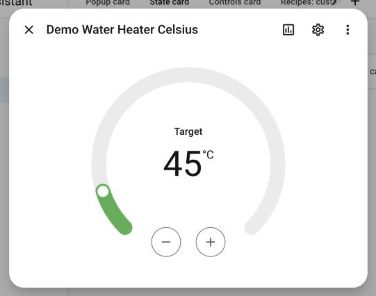

<sub>Shown inside a popup bound to `water_heater.demo_water_heater_celsius`.</sub>

```yaml
type: custom:more-info-state-card
entity: water_heater.demo_water_heater_celsius
```

### vacuum_status

Vacuum illustration (animated while cleaning).

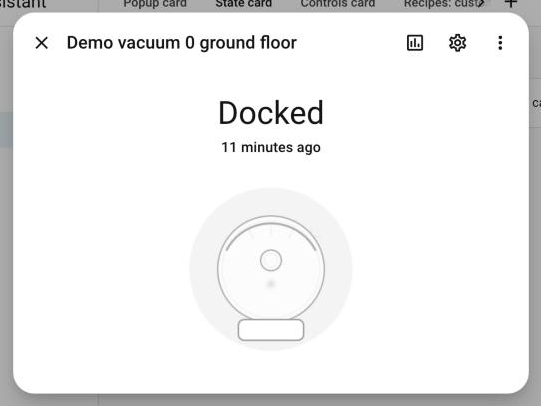

<sub>Shown inside a popup bound to `vacuum.demo_vacuum_0_ground_floor`.</sub>

```yaml
type: custom:more-info-state-card
entity: vacuum.demo_vacuum_0_ground_floor
```

## Options

### Custom state text

`state_override` replaces the state text.

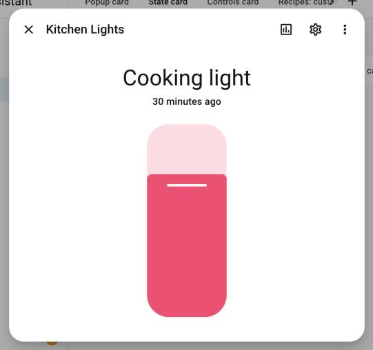

<sub>Shown inside a popup bound to `light.kitchen_lights`.</sub>

```yaml
type: custom:more-info-state-card
entity: light.kitchen_lights
state_override: "Cooking light"
```

### Without last changed

`show_last_changed: false` keeps only the state.

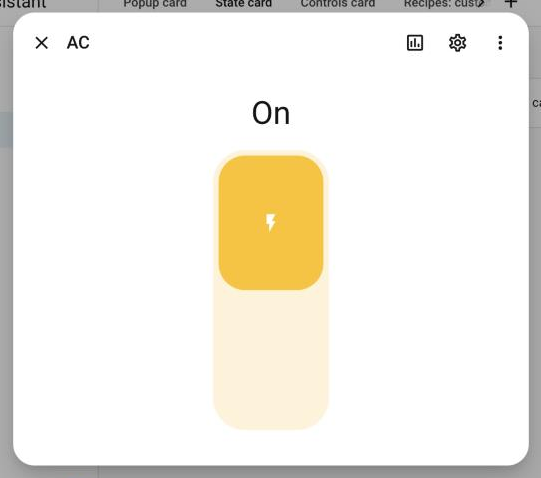

<sub>Shown inside a popup bound to `switch.ac`.</sub>

```yaml
type: custom:more-info-state-card
entity: switch.ac
show_last_changed: false
```

### Header only

`control: none`.

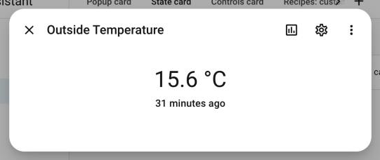

<sub>Shown inside a popup bound to `sensor.outside_temperature`.</sub>

```yaml
type: custom:more-info-state-card
entity: sensor.outside_temperature
control: none
```

### A different control

Force `toggle` on a dimmable light.

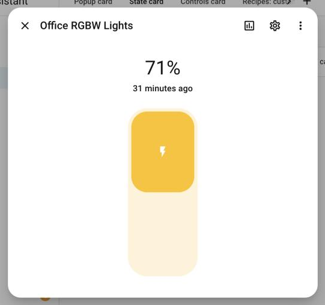

<sub>Shown inside a popup bound to `light.office_rgbw_lights`.</sub>

```yaml
type: custom:more-info-state-card
entity: light.office_rgbw_lights
control: toggle
```

### Control only

`show_state: false`.

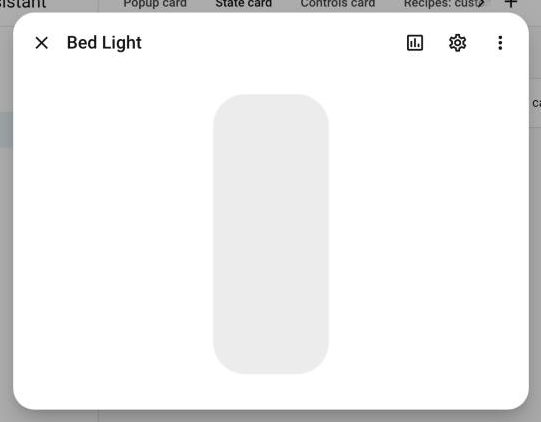

<sub>Shown inside a popup bound to `light.bed_light`.</sub>

```yaml
type: custom:more-info-state-card
entity: light.bed_light
show_state: false
```

### Card appearance

`appearance: card` draws a regular card (default `plain` has no frame, like more-info).

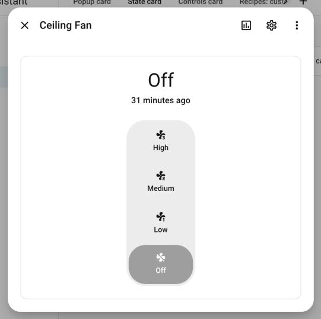

<sub>Shown inside a popup bound to `fan.ceiling_fan`.</sub>

```yaml
type: custom:more-info-state-card
entity: fan.ceiling_fan
appearance: card
```
